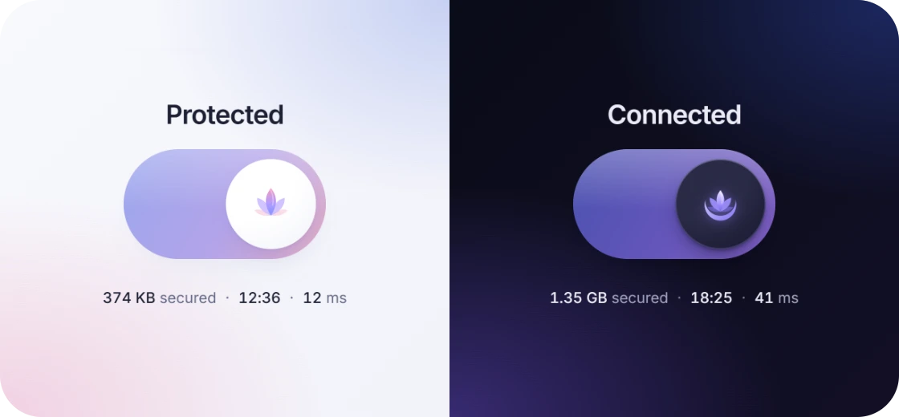
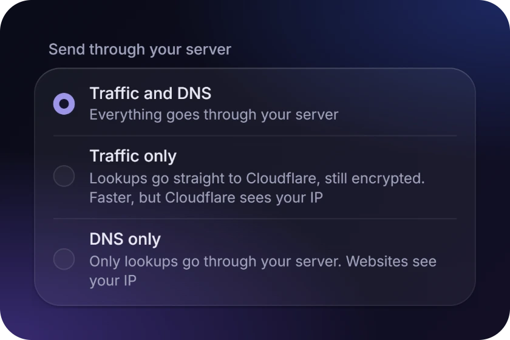
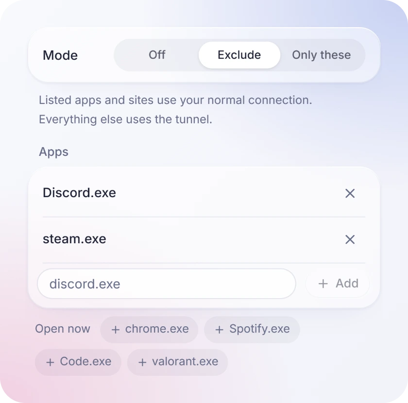
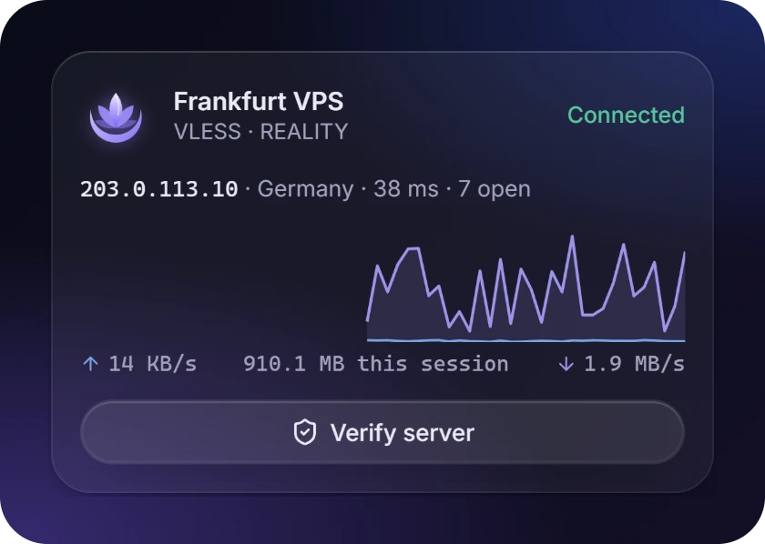
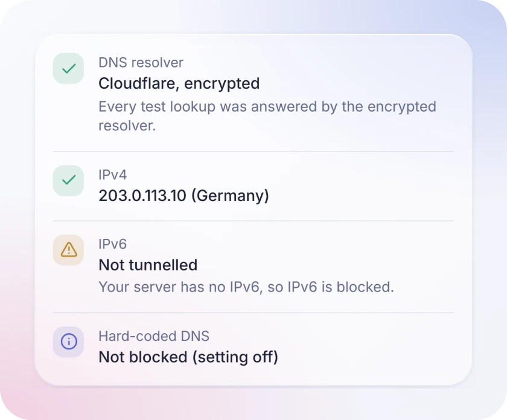
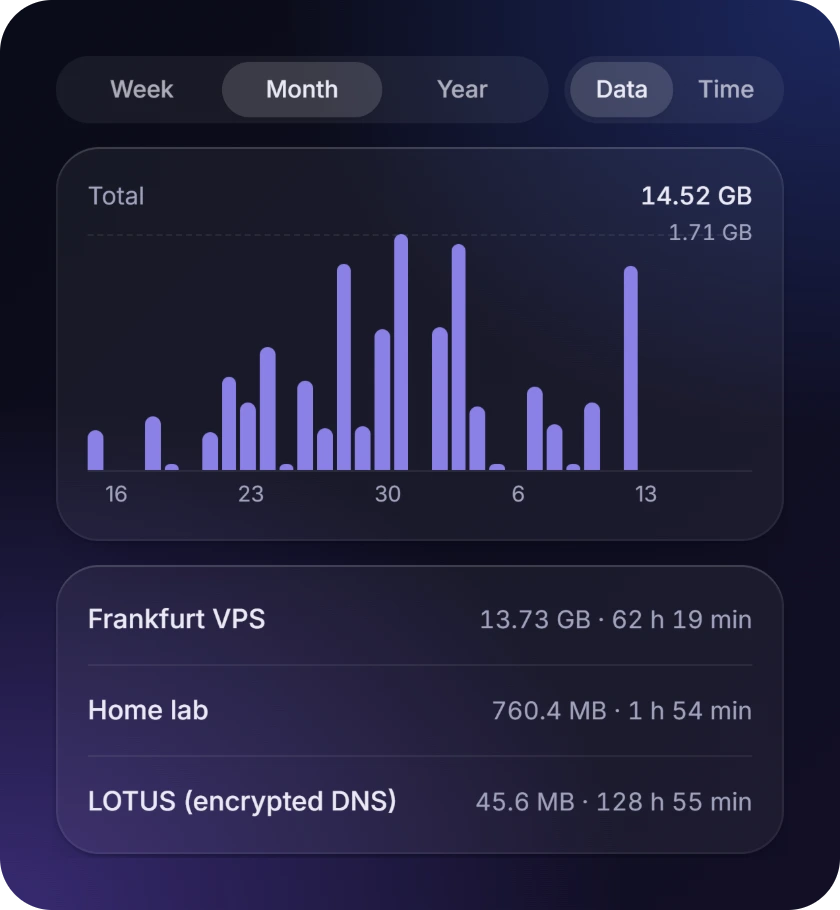
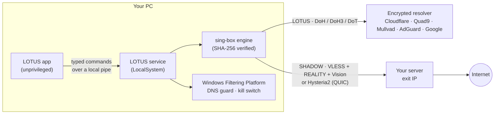

<div align="center">


### Private DNS and a bring-your-own-server VPN for Windows

[](https://github.com/HighSkai/Lotus/releases/latest)
[](#install)
[](LICENSE)
[](https://github.com/SagerNet/sing-box)
[](docs/ARCHITECTURE.md)

[**Download**](https://github.com/HighSkai/Lotus/releases/latest) &nbsp;·&nbsp; [Set up your server](docs/BYO-SERVER.md) &nbsp;·&nbsp; [How it works](docs/ARCHITECTURE.md) &nbsp;·&nbsp; [Privacy](docs/PRIVACY-SECURITY.md) &nbsp;·&nbsp; [Test results](docs/TESTING.md)

</div>

---

LOTUS is a small Windows app with one switch and two ways to protect you. No account, no subscription, no telemetry, and no LOTUS servers in the middle: you pick the resolver, and you run the server.



### One switch, two modes

**LOTUS** encrypts every DNS lookup on your PC, from every app. Your IP address stays the same, and nothing else changes.

**SHADOW** sends all your traffic through an encrypted tunnel to a server you own, so websites see your server instead of you.

Under the switch, each mode shows what it has secured, how long it has been on, and its latency.

<br clear="right">



### Choose what goes through your server

- **Traffic and DNS:** everything takes the tunnel. The default.
- **Traffic only:** lookups go straight to your encrypted resolver, which is faster.
- **DNS only:** just your lookups go through the server; websites still see your own IP.

Change it while connected and it applies at once. If the new setting can't connect, the previous one comes straight back.

<br clear="left">



### Split tunnelling

Keep games, calls and streaming on your normal connection while everything else uses the tunnel. Or flip it around and send **only** the apps and sites you choose.

Pick apps from the ones open now, or type a name like `discord.exe`. Sites can be a domain (subdomains included), an IP address or a range.

Excluded traffic keeps full speed, and *data secured* counts only what actually used the tunnel.

<br clear="right">



### Watch your server at work

The live console shows your exit address, latency, open connections and live throughput, and lists every connection with whether it uses the tunnel.

**Verify server** proves it's really your server (an authenticated handshake) and shows what a stranger probing it would see. With REALITY, that's the camouflage site's real certificate.

<br clear="left">



### Check for leaks in one click

The privacy check asks which resolver really answers your lookups, where your IPv4 and IPv6 traffic leaves, whether Windows routes everything through the tunnel, and whether the kill switch is armed.

Every result comes with a plain explanation, so a warning tells you what to do about it.

<br clear="right">



### Usage that stays on your PC

See data and time by day, month or year, for each server and for LOTUS mode.

Only totals are kept, never the sites you visit, and only on your PC. Turn it off or clear it at any time.

<br clear="left">

## Also built in

- **Honest status.** SHADOW says *Connected* only after a real handshake with your server and a test request through Windows' own routing came back from your server's address. LOTUS says *Protected* only once the encrypted resolver has answered.
- **A kill switch that survives crashes.** Windows Filtering Platform rules let only the tunnel through. In testing, killing the engine or the LOTUS service leaked nothing, and the connection came back by itself.
- **Switch without dropping out.** Choosing the other mode leaves your connection on until you press the switch.
- **Secure by default.** There is no "allow insecure" option. Links that turn off certificate checks or use unencrypted or outdated protocols are refused, with an explanation.
- **Private by design.** No accounts and no analytics. Engine logs stay in memory with addresses removed, and saved servers are encrypted with your Windows account.
- **Bring your own server.** Paste a `vless://`, `ss://`, `trojan://`, `hysteria2://`, `tuic://`, `anytls://` or `naive+https://` link, a WireGuard `.conf` or sing-box JSON, or run the included installer on a fresh VPS.
- **Updates itself.** Signed updates download in the background and install only when you choose *Restart to update*.
- **Light and calm.** Ready about 120 ms after launch, about 5 MB in the tray, and animations you can set to Full, Less or None.

## LOTUS and SHADOW compared

| | **LOTUS** · private DNS | **SHADOW** · your own VPN |
|---|---|---|
| **Protects** | Every DNS lookup, from every app | All traffic: TCP and UDP, IPv4 and IPv6 |
| **Your public IP** | Unchanged, by design | Your server's |
| **Needs a server** | No | Yes: a Debian, Ubuntu or Arch Linux VPS, set up with one script |
| **Encryption** | DNS-over-HTTPS, DNS-over-HTTP/3, DNS-over-TLS | VLESS + REALITY + Vision by default; also Hysteria2, Trojan, Shadowsocks-2022, TUIC, AnyTLS, NaiveProxy, WireGuard |
| **Leak protection** | Every network adapter uses LOTUS; plain DNS to anything else is blocked | Whole-device tunnel, DNS through the tunnel, a kill switch that survives crashes |
| **You choose** | Resolver, protocol, tracker and malware blocking | What goes through the server, and which apps and sites skip it |

LOTUS mode can't hide your IP address. Only relaying your traffic through another machine can, and that's what SHADOW does. More in [LOTUS vs SHADOW](docs/MODES.md).

## How it works



The window you click on has no special permissions. A small Windows service does the privileged work (DNS settings, the tunnel adapter, firewall rules) and accepts only a fixed set of typed commands: never raw engine configuration, file paths or programs to run. Details in [ARCHITECTURE.md](docs/ARCHITECTURE.md).

## Install

1. Download **`LOTUS_1.6.1_x64-setup.exe`** from the [latest release](https://github.com/HighSkai/Lotus/releases/latest) and approve the administrator prompt.
2. Open LOTUS, choose **LOTUS** or **SHADOW** at the top, and press the switch.

Requires Windows 10 or 11 (x64). WebView2 comes with Windows 11 and is installed automatically if missing.

> [!NOTE]
> The installer isn't code-signed yet, so SmartScreen may show *"Windows protected your PC"*. Check the SHA-256 published with the release, then choose **More info → Run anyway**.

LOTUS keeps itself up to date from version 1.2.0 on. If you have 1.1.0 or earlier, install the latest version once by hand.

To uninstall, use **Settings → Apps → LOTUS**. It stops the service, restores your original DNS settings and removes every LOTUS firewall rule.

## Set up your own server (SHADOW)

Any VPS or Linux machine with a public IP address, x86-64 or ARM64:

| Distribution | Versions |
|---|---|
| Debian | 12, 13 |
| Ubuntu | 22.04, 24.04 |
| Arch Linux | Rolling, including Manjaro, EndeavourOS and other Arch-based systems |

```bash
curl -fsSLO https://github.com/HighSkai/Lotus/releases/latest/download/lotus-server-install.sh
sudo bash lotus-server-install.sh        # add --with-hysteria2 for a UDP/QUIC profile as well
```

The script:

- checks the sing-box download against a pinned SHA-256
- generates REALITY keys and installs a hardened systemd service
- asks before opening ports, and never overwrites existing firewall rules
- tests the result with a real handshake, then prints your `lotus://` link

Paste the link into **LOTUS → Add server → Paste**. Remove everything with `--uninstall`. The full guide is in [BYO-SERVER.md](docs/BYO-SERVER.md).

## Why VLESS + REALITY + Vision?

Of the maintained options in late 2026, it strikes the best balance:

- **It looks ordinary.** The handshake looks like a current browser's TLS 1.3 visit to a real, popular website.
- **It's hard to probe.** Anyone without your key is quietly passed to that real site and sees its real certificate.
- **It's easy to run.** No domain or certificate needed.
- **It's fast.** Vision avoids encrypting already-encrypted traffic twice; measured close to 1 Gbps through the full Windows tunnel.

Hysteria2 (QUIC, with a browser-like handshake and a pinned server key) is the alternative for lossy connections. The research, including what was rejected and why, is in [PROTOCOLS.md](docs/PROTOCOLS.md).

> [!IMPORTANT]
> No tool makes traffic undetectable, and LOTUS doesn't claim to. It raises the cost of detection and keeps your data encrypted. Use it lawfully and within your network's rules.

## Tested, not assumed

Each result was checked on a real Windows 11 PC with Windows' own tools and packet captures of the network card.

| Check | Result |
|---|---|
| LOTUS: every resolver answers over DoH, DoH3 and DoT, with TLS 1.3 | Pass (16 of 16) |
| LOTUS: plain DNS on the wire while on | None (0 of 1,338 packets) |
| LOTUS: apps with hard-coded DNS (8.8.8.8:53) | Blocked |
| LOTUS: data secured vs a packet capture | Identical, to the byte |
| SHADOW: share of bytes going to your server | 99.7%, nothing anywhere else |
| SHADOW: an unencrypted web request | Not readable on the wire |
| SHADOW: IPv4 and IPv6, TCP and UDP routed via the tunnel | Pass |
| Split tunnelling and "send through your server" choices, judged at both ends | Routed as set, in every mode |
| Kill switch: deliberate bypass attempt (IPv4 and IPv6) | Blocked |
| Engine killed mid-session: leak / recovery | None / about 2 s |
| Service killed mid-session: leak / recovery | None / about 5 s |
| Time to connect, including checks | About 1.9 s |
| Uninstall while connected | DNS restored, no rules left |

LOTUS has also been run against real servers: a Google Cloud Debian VM (exit IP changed, all privacy checks pass, and probing it from outside shows only the camouflage site) and an Arch Linux machine. The full audit, performance figures, and what hasn't been verified yet are in [TESTING.md](docs/TESTING.md).

## Build from source

Requires Windows 10/11 x64, Rust (stable, MSVC), Visual Studio 2022 Build Tools (C++) and Node.js 20+.

```powershell
git clone https://github.com/HighSkai/Lotus.git
cd Lotus
powershell -ExecutionPolicy Bypass -File scripts\build.ps1
```

`build.ps1` fetches the pinned engine (SHA-256 verified), runs the tests (every generated engine configuration is checked by the real `sing-box check`), builds the service and the app, and writes the installer to `target\release\bundle\nsis\`. If the update signing key exists at `%USERPROFILE%\.tauri\lotus-updater.key`, it also signs the installer and writes `latest.json`; upload both with the release so installed copies can update.

<details>
<summary>Development loop and command-line control</summary>

```powershell
powershell -ExecutionPolicy Bypass -File scripts\fetch-engine.ps1
cargo build -p lotus-service
# once, elevated: registers the service from target\debug (development only)
powershell -ExecutionPolicy Bypass -File scripts\dev-install.ps1 -AllowUserControl
cd app; npm install; npx tauri dev
```

Run `cd app; npm run dev` on its own to preview the interface in a browser at http://127.0.0.1:1420 with sample data, no service needed.

Drive the service from a terminal with `lotus-service ctl status | lotus | shadow <link> | test <link> | verify <link> | connections | usage | diag | speed | logs | disconnect`.
</details>

## Project layout

```
crates/lotus-core      profiles, importers, validation, engine configuration, IPC types (no OS calls)
crates/lotus-service   privileged Windows service: engine supervisor, DNS, firewall, named-pipe IPC
app/                   Tauri 2 + React desktop app (unprivileged): tray, encrypted server store, signed updater
server/                exit-server installer (Debian, Ubuntu, Arch Linux)
scripts/               pinned engine fetch, release build, development install, failure tests
docs/                  documentation
```

## Documentation

| Guide | What it covers |
|---|---|
| [LOTUS vs SHADOW](docs/MODES.md) | What each mode protects, and what it doesn't |
| [Bring your own server](docs/BYO-SERVER.md) | The installer, existing servers, manual setup, choosing a camouflage site |
| [Protocols](docs/PROTOCOLS.md) | Research, choices and supported formats |
| [Architecture](docs/ARCHITECTURE.md) | Components, security boundaries, IPC, plans for macOS and Linux |
| [Privacy & security](docs/PRIVACY-SECURITY.md) | What LOTUS contacts, the threat model, limitations |
| [Testing](docs/TESTING.md) | Every test, how it was run, and the results |
| [Troubleshooting](docs/TROUBLESHOOTING.md) | Common problems and fixes |

## License

LOTUS is free software under the [GNU General Public License v3.0 or later](LICENSE).

It builds on [sing-box](https://github.com/SagerNet/sing-box) (GPL-3.0-or-later), [Tauri](https://tauri.app), [React](https://react.dev), [shadcn/ui](https://ui.shadcn.com), [Motion](https://motion.dev) and the [sing-geosite](https://github.com/SagerNet/sing-geosite) rule-set. See [THIRD_PARTY_NOTICES.md](THIRD_PARTY_NOTICES.md).
