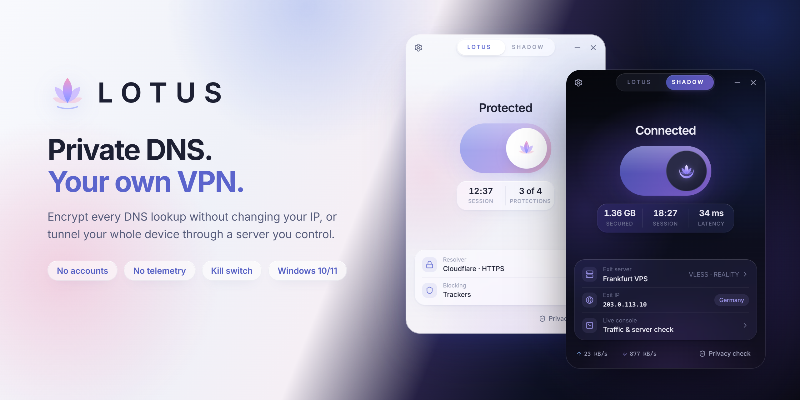
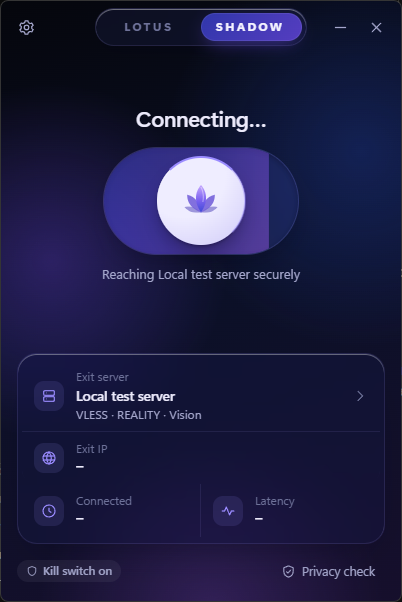
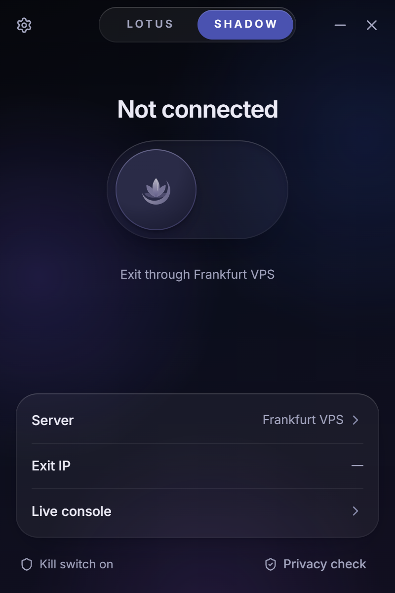
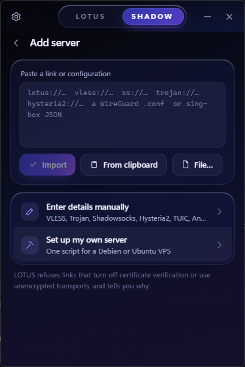
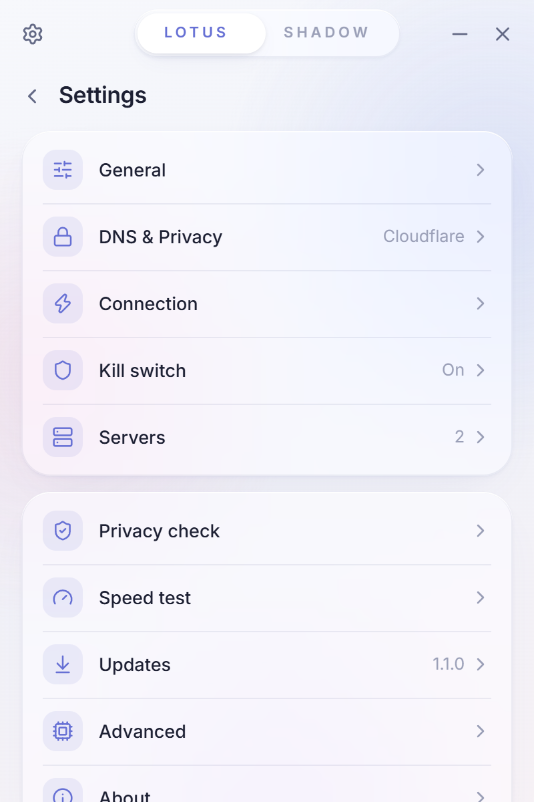
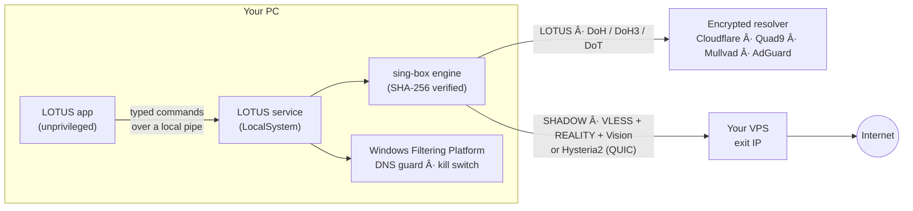

<div align="center">



### Private DNS and a bring-your-own-server VPN for Windows

[](https://github.com/HighSkai/Lotus/releases/latest)
[](#install)
[](LICENSE)
[](https://github.com/SagerNet/sing-box)
[](docs/ARCHITECTURE.md)

[**Download**](https://github.com/HighSkai/Lotus/releases/latest) &nbsp;·&nbsp; [Set up your server](docs/BYO-SERVER.md) &nbsp;·&nbsp; [How it works](docs/ARCHITECTURE.md) &nbsp;·&nbsp; [Privacy](docs/PRIVACY-SECURITY.md) &nbsp;·&nbsp; [Test results](docs/TESTING.md)

</div>

---

LOTUS is a small, fast desktop app with one big switch and two ways to protect you. **LOTUS mode** encrypts every DNS lookup on your PC without changing your IP address. **SHADOW mode** sends your entire device's traffic through an encrypted tunnel to a server *you* own, so websites see your server instead of you.

There's no account, no subscription, no telemetry, and no central LOTUS infrastructure. You choose the resolver, and you run the server.

## Two modes, one switch

| | 🌸 **LOTUS**: private DNS | 🌑 **SHADOW**: your own VPN |
|---|---|---|
| **What it protects** | Every DNS lookup, from every app | All traffic from the device: TCP and UDP, IPv4 and IPv6 |
| **Your public IP** | Unchanged (by design) | Your server's IP |
| **Needs a server** | No | Yes, any Debian, Ubuntu or Arch Linux VPS (one-script setup) |
| **Encryption** | DNS-over-HTTPS, DoH over HTTP/3, DNS-over-TLS | VLESS + REALITY + XTLS-Vision by default; Hysteria2, Trojan, Shadowsocks-2022, TUIC, AnyTLS, NaiveProxy, WireGuard |
| **Leak protection** | Every adapter uses LOTUS; plaintext DNS to any other server is blocked | Full TUN routing, DNS through the tunnel, persistent kill switch |
| **Extras** | Tracker blocking, malicious-domain filtering, custom resolvers | Server latency test, live exit IP and country, traffic meter |

> LOTUS mode can't hide your IP: that's only possible by relaying traffic through another machine, which is exactly what SHADOW does. Read more in [LOTUS vs SHADOW](docs/MODES.md).

## Screenshots

<table>
  <tr>
    <td align="center"><br><sub>LOTUS: ready</sub></td>
    <td align="center"><br><sub>LOTUS: DNS protected</sub></td>
    <td align="center"><br><sub>SHADOW: connecting</sub></td>
  </tr>
  <tr>
    <td align="center"><br><sub>SHADOW: midnight theme</sub></td>
    <td align="center"><br><sub>Import any server link</sub></td>
    <td align="center"><br><sub>Settings</sub></td>
  </tr>
</table>

## Highlights

- **Honest status.** SHADOW reports *Connected* only after a real handshake with your server **and** a request through Windows' own routing came back from your server's IP. LOTUS reports *Protected* only after the encrypted resolver actually answered.
- **A kill switch that survives crashes.** Persistent Windows Filtering Platform rules allow only the tunnel. In testing, killing the engine *or the LOTUS service itself* leaked nothing, and the connection came back by itself.
- **Bring your own server.** Paste a `vless://`, `ss://`, `trojan://`, `hysteria2://`, `tuic://`, `anytls://`, `naive+https://` link, a WireGuard `.conf` or sing-box JSON. Or run the included installer on a fresh VPS and paste the `lotus://` link it prints.
- **Secure by default.** There is no "allow insecure" switch anywhere. Links that disable certificate checks, or use unencrypted or obsolete protocols, are refused with an explanation.
- **Privacy by design.** No accounts or analytics. Engine logs stay in memory at warning level with addresses scrubbed. Server profiles are encrypted with your Windows account (DPAPI).
- **Light.** The background service uses ~17 MB, and the networking engine ~41–66 MB while on (none when off). With the window closed, LOTUS releases its web view completely and idles at ~5 MB.

## How it works



The window you click on has **no privileges**. A small Windows service does the privileged work (DNS settings, the tunnel adapter, firewall rules) and accepts only a fixed set of typed commands. It never takes raw engine configuration, file paths or programs to run. Details in [ARCHITECTURE.md](docs/ARCHITECTURE.md).

## Install

1. Download **`LOTUS_1.0.1_x64-setup.exe`** from the [latest release](https://github.com/HighSkai/Lotus/releases/latest) and approve the administrator prompt.
2. Open LOTUS, choose **LOTUS** or **SHADOW** at the top, and press the switch.

Requirements: Windows 10 or 11 (x64). WebView2 ships with Windows 11 and is installed automatically if missing.

> **Note:** the installer isn't code-signed yet, so SmartScreen may say *"Windows protected your PC"*. Choose **More info → Run anyway** after checking the SHA-256 published with the release.

Uninstalling (Settings → Apps → LOTUS) stops the service, restores your original DNS settings and removes every LOTUS firewall rule.

## Set up your own server (SHADOW)

On a VPS (or any Linux machine with a public IP) running one of:

| Distribution | Versions |
|---|---|
| Debian | 12, 13 |
| Ubuntu | 22.04, 24.04 |
| **Arch Linux** | rolling (also Manjaro, EndeavourOS and other Arch derivatives) |

x86-64 and ARM64 are both supported.

```bash
curl -fsSLO https://github.com/HighSkai/Lotus/releases/latest/download/lotus-server-install.sh
sudo bash lotus-server-install.sh                 # add --with-hysteria2 for a UDP/QUIC profile too
```

The script verifies the sing-box download against a pinned SHA-256, generates REALITY keys, installs a hardened systemd service, **asks** before opening ports (it never overwrites existing firewall rules), and checks the result with a real handshake before printing your `lotus://` link. Paste the link into **LOTUS → Add server → From clipboard**. Remove everything with `--uninstall`. Full guide: [BYO-SERVER.md](docs/BYO-SERVER.md).

## Why VLESS + REALITY + Vision?

Of the maintained options in late 2026, it gives the best balance:

- **It looks ordinary.** The handshake is a current-browser-style TLS 1.3 visit to a real, popular website.
- **It's hard to probe.** Anyone who isn't authenticated is quietly passed to that real site and sees its real certificate.
- **It's easy to run.** It needs no domain or certificate.
- **It's fast.** Vision avoids double-encrypting traffic that is already encrypted; measured close to line rate (~1 Gbps) through the full Windows tunnel.

Hysteria2 (QUIC, with Chrome-like handshake parroting and a pinned server key) is the second option for lossy links. The full research, including what was rejected and why, is in [PROTOCOLS.md](docs/PROTOCOLS.md).

> **No tool makes traffic undetectable**, and LOTUS doesn't claim to. It raises the cost of detection and keeps your data encrypted. Use it lawfully and in line with your network's rules.

## Verified, not assumed

Every claim above was checked on a real Windows 11 PC with Windows' own tools. A few results:

| Check | Result |
|---|---|
| LOTUS: lookups answered by the encrypted resolver, not the ISP | ✅ |
| LOTUS: apps with hard-coded DNS (8.8.8.8:53) blocked | ✅ |
| SHADOW: all IPv4/IPv6 routes via the tunnel, TCP + UDP | ✅ |
| Kill switch: deliberate bypass attempt blocked | ✅ |
| Engine killed mid-session: leak / recovery | none / ~2 s |
| Service killed mid-session: leak / recovery | none / ~5 s |
| Connect time (incl. verification) | ~1.9 s |
| Throughput through the tunnel vs direct | ~0.5–1.2 Gbps vs ~0.7–1.25 Gbps |
| Uninstall while active: DNS restored, no rules left | ✅ |

What *hasn't* been verified yet (a remote VPS exit, Wi-Fi/sleep transitions, Windows 10) is listed honestly in [TESTING.md](docs/TESTING.md).

## Build from source

Requires Windows 10/11 x64, Rust (stable, MSVC), Visual Studio 2022 Build Tools (C++), and Node.js 20+.

```powershell
git clone https://github.com/HighSkai/Lotus.git
cd Lotus
powershell -ExecutionPolicy Bypass -File scripts\build.ps1
```

`build.ps1` fetches the pinned engine (SHA-256 verified), runs the test suite (every generated engine config is validated by the real `sing-box check`), builds the service and app, and writes the installer to `target\release\bundle\nsis\`.

<details>
<summary>Development loop and command-line control</summary>

```powershell
powershell -ExecutionPolicy Bypass -File scripts\fetch-engine.ps1
cargo build -p lotus-service
# once, elevated: registers the service from target\debug (development only)
powershell -ExecutionPolicy Bypass -File scripts\dev-install.ps1 -AllowUserControl
cd app; npm install; npx tauri dev
```

`lotus-service ctl status | lotus | shadow <link> | test <link> | diag | speed | logs | disconnect` drives the service from a terminal.
</details>

## Project layout

```
crates/lotus-core      profiles, importers, validation, engine config builders, IPC types (no OS calls)
crates/lotus-service   privileged Windows service: engine supervisor, DNS, WFP firewall, named-pipe IPC
app/                   Tauri 2 + React desktop app (unprivileged), tray, encrypted profile store
server/                exit-server installer (Debian, Ubuntu, Arch Linux)
scripts/               pinned engine fetch, release build, dev install, failure-injection tests
docs/                  documentation
```

## Documentation

| | |
|---|---|
| [LOTUS vs SHADOW](docs/MODES.md) | What each mode protects, and what it doesn't |
| [Bring your own server](docs/BYO-SERVER.md) | Installer, existing servers, manual setup, choosing a camouflage site |
| [Protocols](docs/PROTOCOLS.md) | Research, choices, supported formats |
| [Architecture](docs/ARCHITECTURE.md) | Components, security boundaries, IPC, macOS/Linux roadmap |
| [Privacy & security](docs/PRIVACY-SECURITY.md) | What LOTUS contacts, threat model, limitations |
| [Testing](docs/TESTING.md) | Every test, how it was run, measured results |
| [Troubleshooting](docs/TROUBLESHOOTING.md) | Common problems and fixes |

## License

LOTUS is free software, licensed under the [GNU General Public License v3.0 or later](LICENSE).

It builds on [sing-box](https://github.com/SagerNet/sing-box) (GPL-3.0-or-later), [Tauri](https://tauri.app), [React](https://react.dev) and the [sing-geosite](https://github.com/SagerNet/sing-geosite) rule-set. See [THIRD_PARTY_NOTICES.md](THIRD_PARTY_NOTICES.md).
